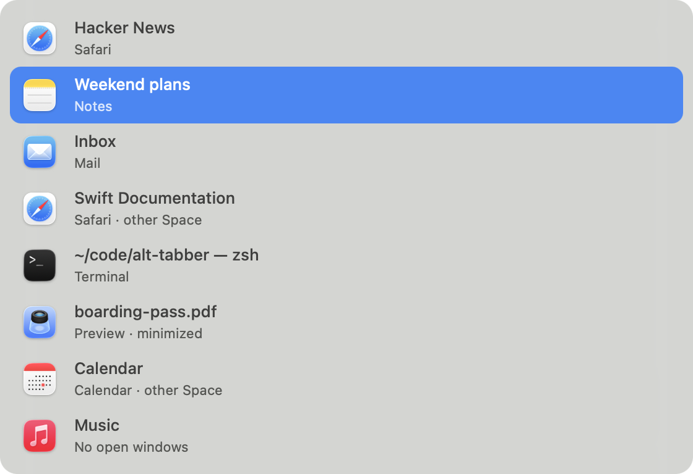

# alt-tabber

Windows-style window switching for macOS. Free, open source, and nothing to upgrade.

Cmd-Tab switches apps. alt-tabber switches **windows**: every window of every app, on every Space, in the order you last used them.



## Install

```sh
brew install --cask alcun/tap/alt-tabber
```

Open it, then allow it in **System Settings → Privacy & Security → Accessibility**. It starts working straight away. A stack icon in the menu bar has **Launch at Login** and **Quit**.

Needs macOS 14 or later on Apple silicon.

## Use

| Keys | Does |
| --- | --- |
| **Option-Tab** | Open the switcher on your previous window |
| **Tab** / **Shift-Tab**, arrows | Move down / up |
| Release **Option** | Switch to the selected window |
| Type while it's open | Search window titles and app names. You can let go of Option; **Enter** switches |
| **Esc**, or click elsewhere | Cancel |

With the mouse, hover a row to select it and click to switch. A hovered row shows buttons to **minimize**, go **full screen**, **close** the window or **quit** the app.

The list includes:

- windows on other Spaces and fullscreen apps, which it switches to
- minimized windows and hidden apps
- running apps with no open windows, at the end, like Cmd-Tab

## What it doesn't do

No thumbnails, themes, settings, updater, licence keys or tracking. It reads window titles through Accessibility, so it never needs Screen Recording permission.

## Build from source

Needs Xcode 15 or later.

```sh
git clone https://github.com/alcun/alt-tabber
cd alt-tabber
./build.sh
```

This builds `AltTabber.app` and installs it to `~/Applications`. It's signed ad hoc, so macOS asks for Accessibility again after each rebuild. To keep the permission, sign with your own identity: `SIGN_ID="Apple Development: you@example.com" ./build.sh`.

## How it works

About 800 lines of Swift in [`Sources/AltTabber`](Sources/AltTabber):

- `Hotkey.swift` is a keyboard event tap for Option-Tab. It never blocks your typing.
- `Windows.swift` lists windows and tracks the order you used them in.
- `Panel.swift` draws the list. `Switcher.swift` ties them together.
- `Private.swift` holds the private macOS calls.

macOS has no public way to focus another app's window reliably, or to see windows on other Spaces. alt-tabber uses private WindowServer and Accessibility calls for both, so a macOS update could break it. It can't go in the App Store for the same reason.

## Credits

The private calls, and the method for focusing windows and finding them on other Spaces, are adapted from [AltTab](https://github.com/lwouis/alt-tab-macos) by lwouis and contributors. AltTab ported parts of them from [yabai](https://github.com/koekeishiya/yabai) and [Hammerspoon](https://github.com/Hammerspoon/hammerspoon). alt-tabber is a separate project, not affiliated with AltTab.

## Licence

[GPL-3.0](LICENSE), the same as AltTab.
